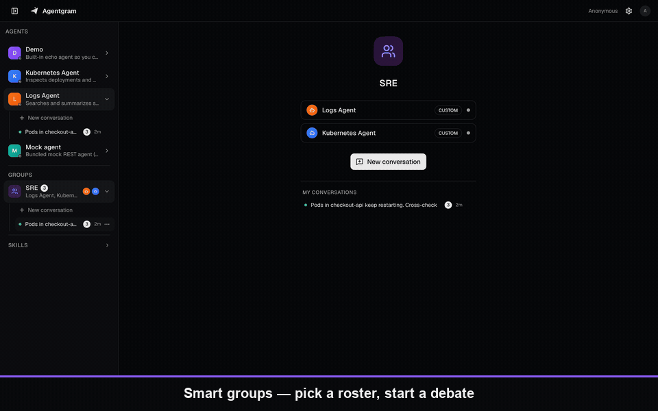
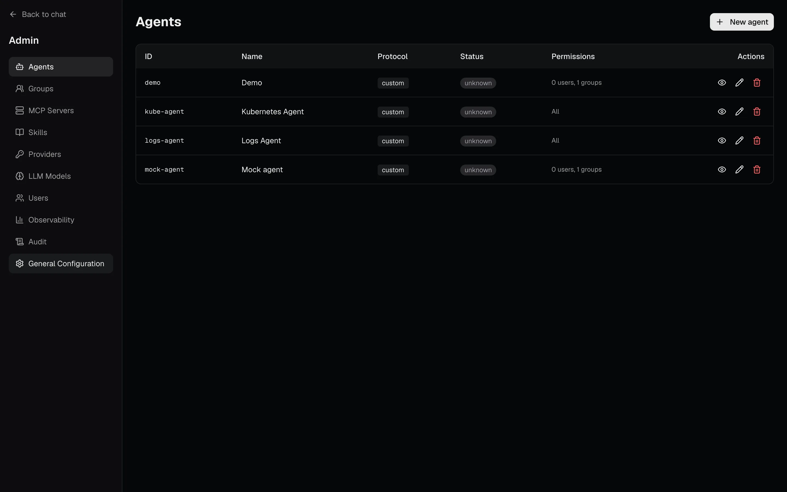
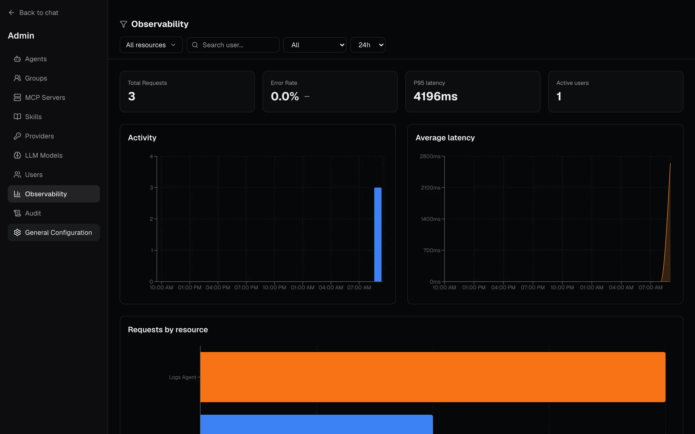
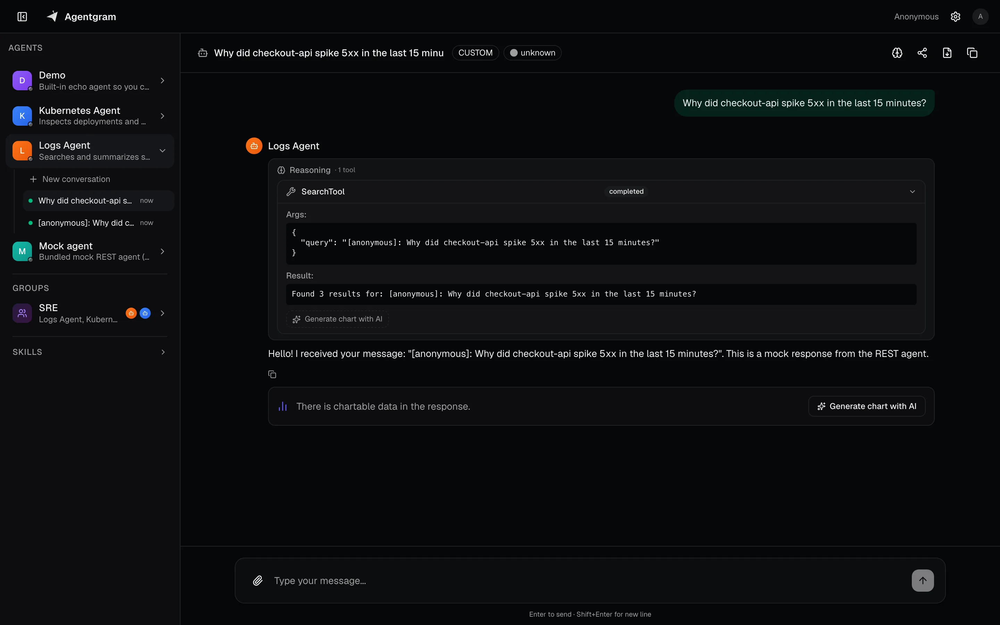
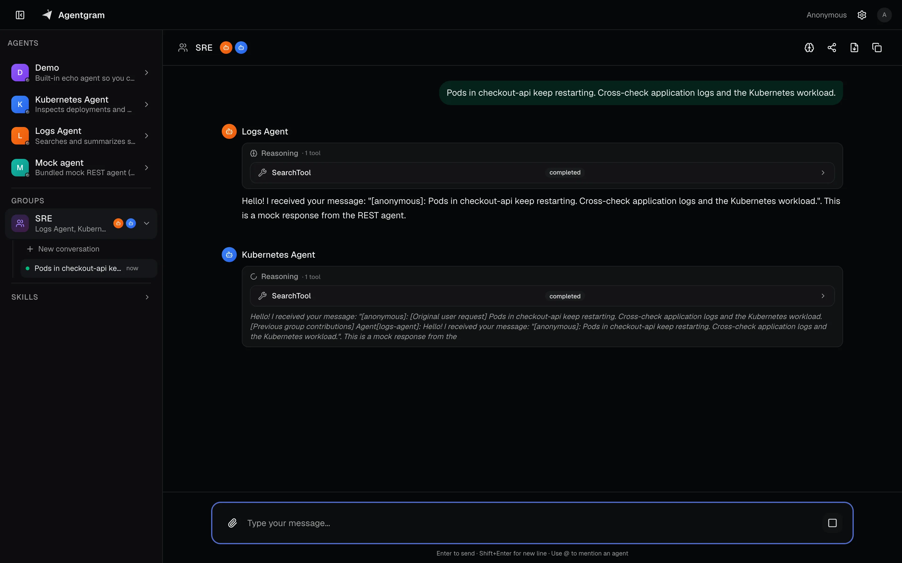

<p align="center">
  
</p>

<h1 align="center">Agentgram</h1>

<p align="center">
  <strong>One gateway for every MCP server and agent.</strong>
</p>

<p align="center">
  Self-hosted MCP and agent gateway: one MCP endpoint and one API in front of everything you run —<br/>
  RBAC per user and group, per-user credentials to each upstream, full audit. Chat and admin console included.
</p>

<p align="center">
  <a href="https://agentgram.eu"></a>
  <a href="https://github.com/dfradehubs/agentgram/stargazers"></a>
  <a href="LICENSE"></a>
  
  
  
  
</p>

<p align="center">
  <strong><a href="https://agentgram.eu">📖 Documentation &amp; guides</a></strong>
</p>

```
  Claude Code · Cursor · Codex ─┐                         ┌─> MCP server (logs)
  claude.ai · any MCP client ───┤   ┌─────────────────┐   ├─> MCP server (k8s)
                                ├──>│    Agentgram    │───┼─> MCP server (SaaS, per-user OAuth)
  Web chat · Slack · your API ──┘   │  auth · RBAC    │   ├─> Agent (A2A)
                                    │  credentials    │   ├─> Agent (Google ADK)
                                    │  audit          │   └─> Agent (REST · SSE)
                                    └─────────────────┘
```

---

## Why

Every team ends up with a pile of MCP servers and agents — one for logs, one for Kubernetes, one
for metrics, a couple of SaaS ones — and every person has to wire each of them into each client,
with its own login and its own API key. N servers × N clients × N credentials, and nobody can say
who has access to what.

Agentgram is the gateway in front of all of them. Register every MCP server and agent your company
runs once; people connect **one MCP endpoint** (or one API) and see exactly the tools they are
entitled to — nothing else. Agentgram authenticates the caller, applies role-based access control
by user and group, picks the right credential for each upstream (the user's own token, a group API
key or a per-user OAuth grant), and records every call in an audit log.

Agents are first-class too: Agentgram talks to each one in its native protocol (custom REST/SSE,
A2A or Google ADK) and exposes it both as an MCP tool and as a uniform
[AG-UI](https://docs.ag-ui.com/) event stream, so no client ever has to care how an agent is built.

## Features

### Gateway

- 🔀 **MCP proxy and aggregation** — put N upstream MCP servers (HTTP or SSE) behind **one MCP endpoint**; their tools are namespaced and listed per caller.
- 🤖 **Agents as MCP tools** — every agent becomes an `ask_<agent>` tool, groups become moderated multi-agent tools, and skills are served as tools too.
- 🛡️ **RBAC** — per-agent, per-MCP-server, per-group and per-skill access by user or group. Each caller only ever sees what they're allowed to.
- 🔑 **Per-user credentials to each upstream** — forward the caller's token, pick an API key by user or group with priorities, or run a per-user OAuth 2.1 grant against third-party MCP servers.
- 🔐 **OAuth for MCP clients** — standard protected-resource metadata pointing at your identity provider (any OIDC: Keycloak, Authentik, Auth0, Zitadel, Google); Dynamic Client Registration or a pre-registered client id.
- 🔌 **Protocol-agnostic agents** — custom REST/SSE, [A2A](docs/AGENT_A2A_CONTRACT.md) (JSON-RPC) and [Google ADK](docs/AGENT_ADK_CONTRACT.md) behind one interface, converted to standard [AG-UI](https://docs.ag-ui.com/) events.
- 📜 **Audit and observability** — every chat, MCP call and admin change in an audit log; usage, latency and cost dashboards out of the box.
- 🧰 **Admin, live** — register agents, MCP servers, LLMs and permissions from the UI or through admin MCP tools, without restarts.

### Console included

- 💬 **Chat** — streaming chat with any agent or MCP server, with tool calls, charts and attachments; sessions persist in Redis and agents stay stateless.
- 👥 **Smart groups** — message several agents at once: an LLM moderator picks who speaks, agents build on each other's replies, and `@mention` steers the roster.
- 🤝 **Share & collaborate** — revocable, time-limited links to conversations (view or clone) and shared groups for a team.
- 💬 **Slack** — reach the same agents from Slack, with each person's own permissions.

<p align="center">
  
</p>

## Screenshots

<table>
  <tr>
    <td width="50%"></td>
    <td width="50%"></td>
  </tr>
  <tr>
    <td align="center"><sub><b>Admin panel</b> — register agents, MCP servers, LLMs and permissions.</sub></td>
    <td align="center"><sub><b>Observability</b> — usage, latency and cost dashboards out of the box.</sub></td>
  </tr>
  <tr>
    <td width="50%"></td>
    <td width="50%"></td>
  </tr>
  <tr>
    <td align="center"><sub><b>Chat</b> — streaming AG-UI responses with tool calls.</sub></td>
    <td align="center"><sub><b>Smart groups</b> — LLM moderator picks who speaks; agents share context.</sub></td>
  </tr>
</table>

## Architecture

```
┌──────────────────────┐     ┌──────────────────────┐     ┌───────────────────┐
│  MCP clients         │────>│        API           │────>│  MCP servers      │
│  (Claude Code, ...)  │<────│     (Go gateway)     │<────│  HTTP · SSE       │
└──────────────────────┘     │                      │     └───────────────────┘
┌──────────────────────┐     │  - JWT / OIDC auth   │     ┌───────────────────┐
│  Web console         │────>│  - RBAC              │────>│  Agents           │
│  (Next.js + AG-UI)   │<────│  - Outbound creds    │<────│  REST · A2A · ADK │
└──────────────────────┘     │  - AG-UI conversion  │     └───────────────────┘
                             │  - Sessions · audit  │
                             └──────────────────────┘
                                        │
                                 Redis · PostgreSQL
```

See [docs/PROTOCOLS_OVERVIEW.md](docs/PROTOCOLS_OVERVIEW.md) for how each protocol is mapped onto AG-UI.

## Quick start

**Requirement:** Docker.

```bash
curl -fsSL https://raw.githubusercontent.com/dfradehubs/agentgram/main/docker-compose.yaml -o docker-compose.yaml
docker compose up -d
```

Open **http://localhost:3000** — a built-in demo agent is already registered, so you can chat immediately.

| Service | URL |
| ------- | --- |
| Web UI  | http://localhost:3000 |
| API / MCP | http://localhost:8080/mcp |

Then point Cursor or Claude Code at the same MCP endpoint:

```bash
claude mcp add --transport http agentgram http://localhost:8080/mcp
```

Auth is **off** in this example. Do not expose it to the public internet. Password login (no Keycloak) and generic OIDC are documented under [Configuration](https://agentgram.eu/docs/configuration/).

### Self-host with the published images

```bash
git clone https://github.com/dfradehubs/agentgram.git
cd agentgram/examples/docker-compose
cp .env.example .env
docker compose up -d
```

A single image (`ghcr.io/dfradehubs/agentgram`) that runs API + UI together is also published; see [Deploying](#deploying-to-the-world).

### Develop from source

**Requirements:** Node.js 22+, Go 1.25+, Docker.

```bash
git clone https://github.com/dfradehubs/agentgram.git
cd agentgram
make install
make docker-up    # API + mock agent + Redis + PostgreSQL + web
```

Laptop mode (no Docker for Redis/Postgres — embedded stores):

```bash
cd api && CONFIG_PATH=configs/config.laptop.yaml go run ./cmd/server
```

Run `make help` to see every available target.

## How it works

A chat request is a list of messages plus an optional session id:

```http
POST /api/agents/{agentId}/chat
Content-Type: application/json
Authorization: Bearer <jwt>     # only when auth is enabled

{
  "messages": [
    { "role": "user", "content": "Hello" }
  ],
  "session_id": "optional-uuid"
}
```

The response is a stream of AG-UI events over SSE — the same shape no matter which protocol the agent speaks:

```
data: {"type":"RUN_STARTED","threadId":"...","runId":"..."}
data: {"type":"TEXT_MESSAGE_START","messageId":"...","role":"assistant"}
data: {"type":"TEXT_MESSAGE_CONTENT","messageId":"...","delta":"Hello"}
data: {"type":"TEXT_MESSAGE_END","messageId":"..."}
data: {"type":"RUN_FINISHED","threadId":"...","runId":"..."}
```

Full API reference: [docs/API.md](docs/API.md). Agent contracts: [REST](docs/AGENT_REST_CONTRACT.md) · [A2A](docs/AGENT_A2A_CONTRACT.md) · [ADK](docs/AGENT_ADK_CONTRACT.md).

## Deploying to the world

Ready-to-use deployment recipes live in [`examples/`](examples/):

- **[Docker Compose](examples/docker-compose/)** — self-host the whole stack (API + web + Redis + PostgreSQL) with the published images. The fastest way to put Agentgram on a server.
- **[Kubernetes (Helm)](examples/kubernetes/)** — production values for the [bjw-s `app-template`](https://github.com/bjw-s/helm-charts) chart, plus an Ingress that routes the web app and the MCP/OAuth endpoints correctly.

Container images are published to GitHub Container Registry on every release:

```
ghcr.io/dfradehubs/agentgram          # API + web in one container
ghcr.io/dfradehubs/agentgram-api
ghcr.io/dfradehubs/agentgram-web
```

## Configuration

The API is configured from a single YAML file (`CONFIG_PATH`, e.g. `api/configs/config.yaml`) that
covers the server, auth, Redis, PostgreSQL, metrics, tracing and the MCP server. Secrets are never
written inline — every sensitive value uses `${ENV:VAR}` and is resolved from the environment:

```yaml
auth:
  enabled: true          # set false to run without login (local / trusted networks)
  keycloak:
    enabled: true
    issuer: "${ENV:KEYCLOAK_ISSUER}"
    client_id: "${ENV:OIDC_CLIENT_ID}"
    client_secret: "${ENV:OIDC_CLIENT_SECRET}"

redis:
  addr: "${ENV:REDIS_ADDR}"
  password: "${ENV:REDIS_PASSWORD}"
```

See [`api/.env.example`](api/.env.example) for the full list of variables.

**Agents are managed at runtime** from the built-in admin panel (`/admin`) and stored in PostgreSQL —
no redeploy needed to add one. For each agent you choose its protocol (Custom / A2A / ADK), its
endpoint, and who can reach it (Google Workspace groups or individual users).

## Model Context Protocol (MCP)

Agentgram ships a standard MCP server that turns your agents into tools for **any MCP-compatible IDE
or CLI** — Claude Code, Cursor, and any other client that speaks the spec. It implements the full
discovery + auth flow defined by the standard — protected resource metadata (RFC 9728), authorization
server discovery (RFC 8414) and **Dynamic Client Registration (RFC 7591)** — so a conformant client
connects with just the URL, nothing to configure by hand:

```bash
claude mcp add --transport http agentgram http://localhost:8080/mcp
```

The client runs the OAuth + DCR flow automatically. Then ask away:

```
Ask logs-agent for the errors in the last 30 minutes of the payment-api service.
```

The endpoint exposes both your **agents** (`ask_<agent-id>`) and the **tools of any MCP server
registered in Agentgram** that you're allowed to use — Agentgram aggregates those upstream servers
and re-exposes their tools, all filtered by your permissions.

Full guide (client setup, automations, tuning): [docs/MCP.md](docs/MCP.md).

## Tech stack

**API** — Go 1.25 · Chi router · Redis (sessions + pub/sub) · PostgreSQL · OpenTelemetry · structured logging.

**Web** — Next.js 16 (App Router) · TypeScript · Tailwind CSS 4 · SSE/AG-UI consumed directly via `fetch` + `ReadableStream` · Pino logging · bilingual UI (English / Spanish).

## Project structure

```
agentgram/
├── api/        # Go API (multiplexer) — proxy, agents, auth, mcp, store, repository
├── web/        # Next.js web client (AG-UI over SSE)
├── docs/       # Architecture, API and protocol contracts
├── examples/   # Docker Compose & Kubernetes deployment recipes
└── Makefile    # Development & build commands
```

Deeper dives: [docs/ARCHITECTURE.md](docs/ARCHITECTURE.md) · [api/CLAUDE.md](api/CLAUDE.md) · [web/CLAUDE.md](web/CLAUDE.md).

## Contributing

Issues and pull requests are welcome. See [CONTRIBUTING.md](CONTRIBUTING.md). Keep PRs focused, run `make test` and `make lint` before pushing, and follow
[Conventional Commits](https://www.conventionalcommits.org/) (`feat:`, `fix:`, `docs:`, …).

## License

Released under the [MIT License](LICENSE). © Daniel Fradejas.
